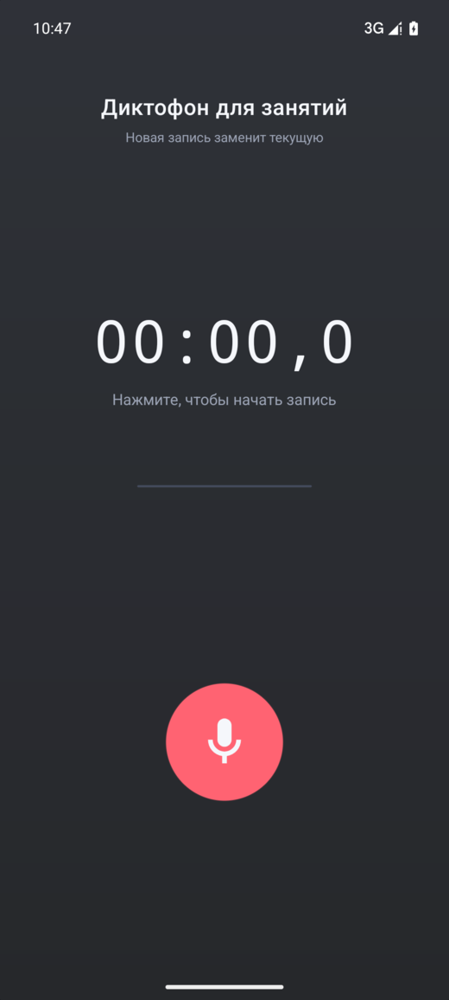
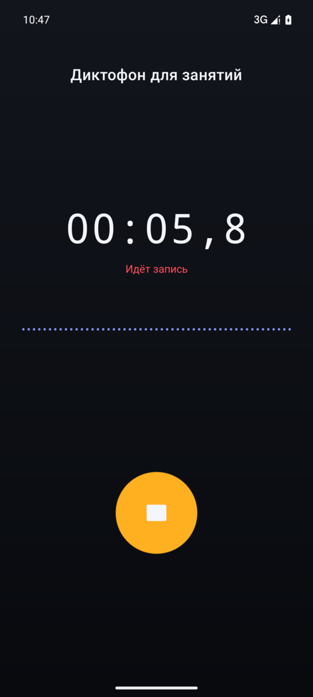
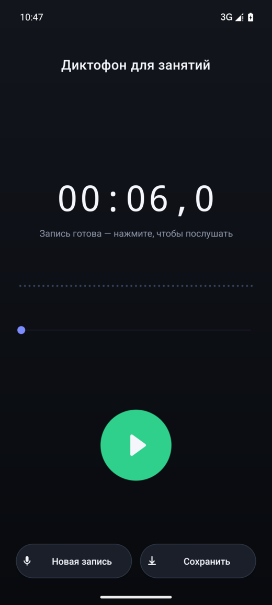
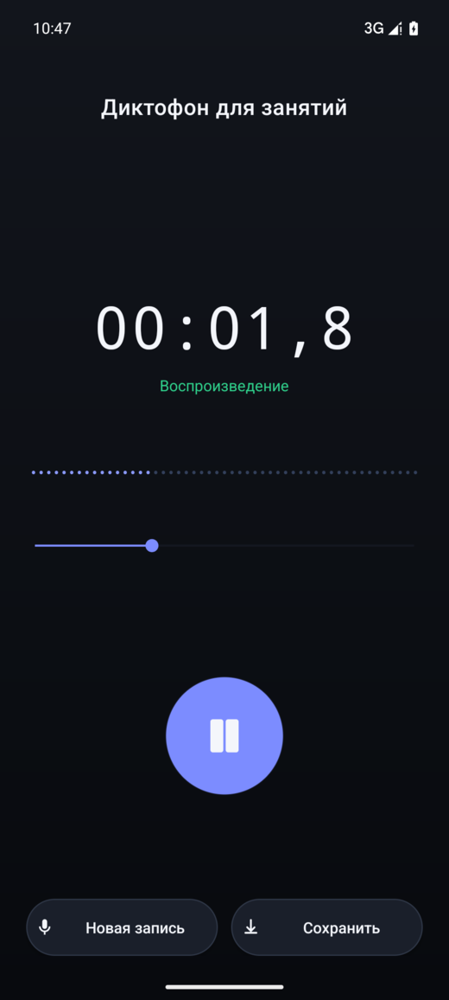
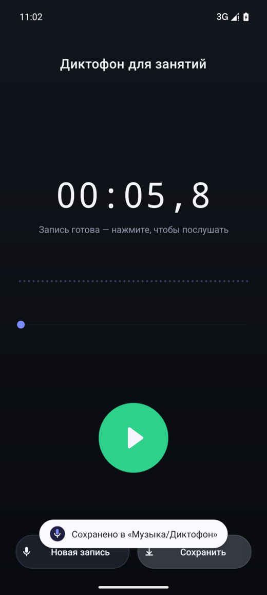

# Voice recorder for speech therapy

**English** · [Русский](README.ru.md)

A simple offline voice recorder for lessons with a speech therapist. One big
button drives the whole cycle: **tap — recording starts, tap — it stops, tap —
playback starts**. A take is not written to files until you press “Save”, and
starting a new recording instantly throws the previous one away.

<p align="center">
  
  
  
  
  
</p>

The UI of the app itself is in Russian.

## Why

Voice and speech practice needs a scratchpad: record a phrase, listen to it,
scrub back, try again. In-between takes should not clutter the gallery, and a
new attempt should start with one tap. Hence:

- everything is recorded into the app cache and never lands in the file system
  on its own;
- “New recording” wipes the previous take without asking;
- only the take you decide to keep is written to a file, and only by pressing
  the button.

## Features

- one-button voice recording (mic, AAC 44.1 kHz, 128 kbps, mono);
- stop with the same button;
- play and pause with the same button;
- scrub to any position, playback continues after the drag;
- live amplitude track and timer;
- “New recording” — drops the current take and starts a new one right away;
- “Save” — a separate button that puts an `.m4a` into `Music/Dictaphone`;
- the screen never sleeps while the app is open;
- pauses when headphones are unplugged or audio focus is lost;
- dark theme, thumb-sized controls, no ads, no internet.

## Install

1. Download `dictaphone-1.0.apk` from the [latest release](../../releases/latest).
2. Open the file on your phone and allow installs from this source.
3. Grant microphone access on the first tap on the record button.

Requires Android 10 (API 29) or newer. The app sends nothing over the network.

## Build

```bash
export JAVA_HOME="$(brew --prefix openjdk@21)/libexec/openjdk.jdk/Contents/Home"
./gradlew assembleDebug        # app/build/outputs/apk/debug/app-debug.apk
./gradlew assembleRelease      # signed app/build/outputs/apk/release/app-release.apk
```

You need an Android SDK with platform 36 and JDK 21. Point the build at the SDK
via `local.properties` (`sdk.dir=...`) or the `ANDROID_HOME` variable.

CI (GitHub Actions, `.github/workflows/build.yml`) builds both APKs on every
push and attaches the signed APK to a release on a `v*` tag.

The signing key `app/dictaphone.jks` (alias and password `dictaphone`) is
committed to the repository — this is a personal tool, not a store release.

## How it works

| File | Purpose |
| --- | --- |
| `MainActivity.java` | screen state machine (idle → recording → ready → playing), recording via `MediaRecorder`, playback via `MediaPlayer`, saving through `MediaStore` |
| `WaveformView.java` | draws the amplitude track and the playback progress |
| `res/layout/activity_main.xml` | the screen: timer, status, track, scrub bar, main button, “New recording” / “Save” |

The temporary take is `cacheDir/session.m4a`. It is deleted on a new recording
and when the screen closes. Saving copies it into `MediaStore`
(`Music/Dictaphone`).

Limitation: recording runs without a foreground service, so on Android 14+ the
microphone may be muted when you switch to another app. The screen stays on
while recording.

## License

MIT — see [LICENSE](LICENSE).
